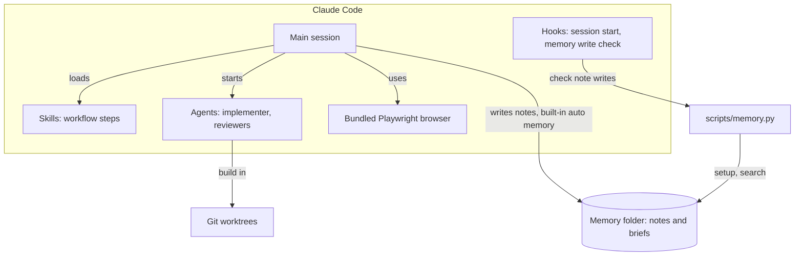

# talk-first-workflow

A Claude Code plugin for talk-first AI development. You talk with the main session, and it only talks back. When you agree on a plan and say start, sub-agents build the change in their own git worktrees, expert reviewers check it, and you decide what happens to it. The point is that nothing gets built before you and the agent agree on what to build, and nothing lands without review and your say.

**Status:** early (0.x), so expect changes between versions. Works on macOS and Linux. Windows is not supported.

## Install

```
/plugin marketplace add sushanpth/talk-first-workflow
/plugin install talk-first-workflow@talk-first-workflow
```

Restart Claude Code after installing. The first session in each repo asks where to keep that project's memory. Requires Claude Code, Python 3 and Node.js with `npx`. See [docs/install.md](docs/install.md) for the browser download, updating, turning it off and uninstalling.

## How it works

You don't run commands or remember steps. The main session follows the workflow by itself and asks you only when a decision is yours.

1. **Talk.** You discuss the problem. The main session reads, searches and explains, but doesn't edit your files.
2. **Plan.** When the talk turns into a change, it restates the task, settles open questions and shows a plan in plain English.
3. **Start.** Nothing is built until you choose to start. You can save the plan to memory first and read it before you start.
4. **Implement.** An implementer agent builds the change on its own branch in its own git worktree, test first, and runs the plan's checks.
5. **Review.** Reviewer agents check the result. Blockers go back to the implementer for up to two fix rounds.
6. **You decide.** Merge locally, open a PR, keep the branch or discard it. You can look at the diff first.

## Architecture



- **Hooks** load the workflow and the project's memory status at session start, and block malformed memory notes before every file write.
- **Skills** hold each workflow step. The main session loads them when it needs them.
- **Agents** do the building and reviewing, each as a separate Claude Code sub-agent.
- **`scripts/memory.py`** handles memory setup, the note format check and search, using the Python standard library only. The main session writes the notes itself under Claude Code's built-in memory rules.
- **The memory folder** is `~/memory/<project>/` by default, with saved plans in `briefs/`.

## Features

- **Talk-only main agent.** It reads, searches, explains and discusses, but doesn't edit project files unless you ask. [Workflow](docs/workflow.md)
- **Per-project memory.** Claude Code's own memory system, moved to a folder per project, in the native note format. [Memory](docs/memory.md)
- **Memory write check.** A hook blocks malformed notes. [Memory](docs/memory.md#memory-write-check)
- **Start gate.** Nothing is built until you choose to start, and the plan can be saved first. [Workflow](docs/workflow.md#start-gate-and-saved-briefs)
- **Implementer.** An agent builds the change test first in its own git worktree and never pushes. [Workflow](docs/workflow.md#implementer)
- **Parallel tracks.** Independent parts of a plan are built at the same time and merged by an integration step. [Workflow](docs/workflow.md#parallel-tracks)
- **Branch names.** Each branch is named from the plan, such as `tf/login-timeout-fix`. [Workflow](docs/workflow.md#branch-names)
- **Reviewers.** Conformance, security and lint always run; architecture and test reviews run when the change calls for them. [Workflow](docs/workflow.md#reviewers)
- **Fix rounds.** Blockers go back to the implementer for up to two rounds. [Workflow](docs/workflow.md#fix-rounds)
- **Merge options.** Merge locally, open a PR, keep the branch, discard or look first. [Workflow](docs/workflow.md#merge-options)
- **Browsing.** WebFetch, a bundled headless browser, and Claude in Chrome for signed-in sites. [Browsing](docs/browsing.md)

## Documentation

- [Install](docs/install.md): requirements, install, update, turn off and uninstall
- [Workflow](docs/workflow.md): the steps, start gate, implementer, tracks, reviewers, merge options and agent models
- [Memory](docs/memory.md): note format, folder layout, settings and the `memory.py` CLI
- [Browsing](docs/browsing.md): how the agent reads and drives web pages
- [Privacy](docs/privacy.md): what stays on your machine and what uses the network
- [Limitations](docs/limitations.md): known limits and good-to-know notes
- [Contributing](docs/contributing.md): local runs, checks, version bumps and repo layout

## Contributing

Issues and pull requests are welcome. If something breaks or reads unclearly, [open an issue](https://github.com/sushanpth/talk-first-workflow/issues). See [docs/contributing.md](docs/contributing.md) for how to run and check local changes.

## Credits

Inspired by Carlos Kelkboom's workflow on the Beyond Coding podcast: [Lead Architect Reveals His Rules for Coding Agents](https://podcasts.apple.com/nz/podcast/lead-architect-reveals-his-rules-for-coding-agents/id1572440477?i=1000796296724).

## License

MIT, see [LICENSE](LICENSE).
