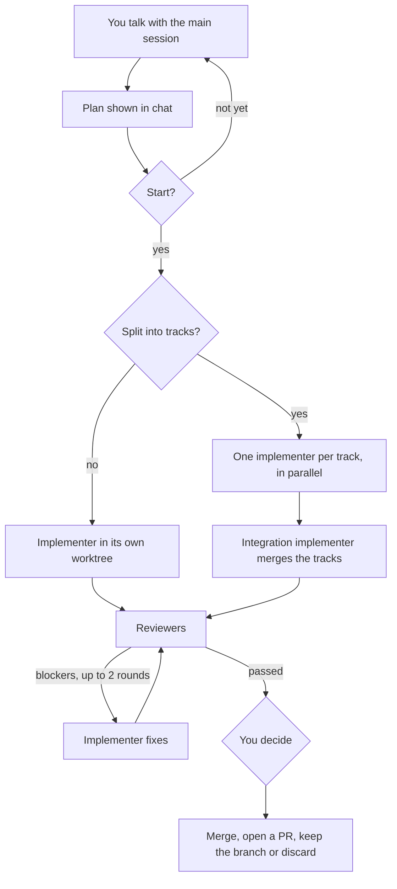
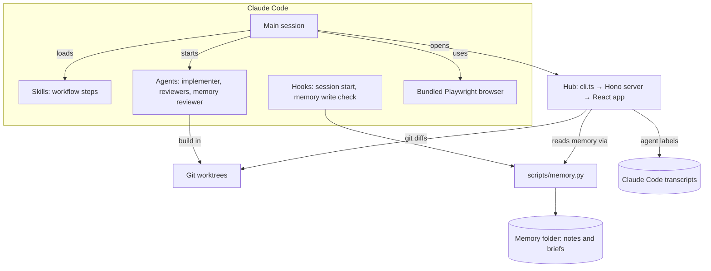

# talk-first-workflow

A Claude Code plugin for talk-first AI development. You talk with the main session, and it only talks back. When you agree on a plan and say start, sub-agents build the change in their own git worktrees, expert reviewers check it, and you decide what happens to it.

**Status:** early (0.x), so expect changes between versions. Works on macOS and Linux. Windows is not supported.

```
/plugin marketplace add sushanpth/talk-first-workflow
/plugin install talk-first-workflow@talk-first-workflow
```

Restart Claude Code after installing. See [Install](#install) for requirements and the optional browser download.

## How it works

You don't run commands or remember steps. The main session follows the workflow by itself and asks you only when a decision is yours.

1. **Talk.** You discuss the problem. The main session reads, searches and explains, but doesn't edit your files.
2. **Plan.** When the talk turns into a change, it restates the task, settles open questions and shows a plan in plain English.
3. **Start.** Nothing is built until you choose to start. You can save the plan to memory first, or open it in the hub.
4. **Implement.** An implementer agent builds the change on its own branch in its own git worktree, test first, and runs the plan's checks.
5. **Review.** Reviewer agents check the result. Blockers go back to the implementer for up to two fix rounds.
6. **You decide.** Merge locally, open a PR, keep the branch or discard it. You can look at the diff in the hub first.



## Architecture



- **Hooks** run at session start (they load the workflow and the project's memory status) and before every file write (they block malformed memory notes).
- **Skills** hold each workflow step. The main session loads them when it needs them.
- **Agents** do the building and reviewing. Each one runs as a separate Claude Code sub-agent.
- **`scripts/memory.py`** is the one place that reads and writes memory: setup, the note format check, search, and JSON for the hub. It uses the Python standard library only.
- **The memory folder** is `~/memory/<project>/` by default, with saved plans in `briefs/`.
- **The hub** is a small local web app: `hub/cli.ts` starts a Hono server, which serves a React app. It reads memory only through `memory.py`, and reads git and Claude Code's transcript folders directly.

## Features

- **Talk-only main agent.** It reads, searches, explains and discusses, but doesn't edit project files unless you ask for a direct edit.
- **Per-project memory.** Claude Code's own memory system, moved to `~/memory/<project>/` (or `<repo>/.memory/` if you want notes committed). Notes keep the native format, with `**Why:**`, `**How to apply:**` and `**Where:**` lines and `[[links]]` between notes.
- **Memory write check.** A hook blocks malformed notes: bad frontmatter, a missing `**Why:**` line or a description that is too long. Before a note is written, a small Haiku agent compares it with the most similar notes and rejects duplicates, contradictions and vague notes. If that agent can't be reached, the note is written with the format check only.
- **Start gate.** Nothing is built until you choose to start. Saving the plan to `<memory>/briefs/` first is recommended for medium and high complexity and skipped for small fixes.
- **Implementer.** An Opus agent builds the change in its own git worktree. It writes a failing test before a behaviour change, finds the root cause before a fix, commits in small steps and never pushes.
- **Parallel tracks.** When a plan splits into independent parts, an optional contract step fixes shared types or file layout first. Then one implementer builds each track at the same time, and an integration implementer merges them and runs the full checks. Reviews run once, on the combined result.
- **Branch names.** Each branch is named from the plan, such as `tf/hub-launcher-fix`. In a parallel run, tracks get `tf/<slug>-<track>` and the integration gets `tf/<slug>`.
- **Reviewers.** Brief conformance, security and lint reviews always run. Architecture review runs for medium and high complexity. Test review runs when core business logic changes.
- **Fix rounds.** Blockers go back to the same implementer, and only the reviewers that failed run again. After two rounds with blockers still open, it stops and asks you.
- **Merge options.** You choose how to finish: merge locally, open a PR (offered when the repo has a remote and `gh` is signed in), keep the branch, fix the remaining should-fix items first, discard (with an option to retry), or look at the diff in the hub first. The buttons adapt to how the project ships, which is kept in a `shipping-preference` memory note. Options without a button can be typed as a reply. It pushes only when you open a PR.
- **Browsing.** WebFetch and WebSearch for plain reading. A bundled Playwright browser (headless Chromium) for pages that need JavaScript, clicking, screenshots or checking your own app. It keeps its profile in memory and shuts down after 10 idle minutes. Claude in Chrome is used for sites where you are signed in or when you want to watch. The agent checks RAM and CPU before opening a browser and closes what it opens.
- **Hub.** A local web page for each project's plans, memory notes, docs and worktree diffs. See [Hub](#hub).

## Install

Requires Claude Code, Python 3 (standard library only) and Node.js with `npx` (for the bundled browser). The optional hub also needs Node.js 22.18 or newer and pnpm.

Install the browser build once (about 400 MB):

```
npx -y @playwright/mcp@0.0.83 install-browser chrome-for-testing
```

If you skip this, the agent asks before downloading it the first time it needs the browser.

Then install the plugin from inside Claude Code:

```
/plugin marketplace add sushanpth/talk-first-workflow
/plugin install talk-first-workflow@talk-first-workflow
```

The full URL (`https://github.com/sushanpth/talk-first-workflow.git`) or a path to a local clone works too.

Restart Claude Code after installing. The first session in each repo asks where to keep that project's memory.

**Update:** `/plugin marketplace update talk-first-workflow`, then `/plugin update talk-first-workflow@talk-first-workflow`, then restart.

**Turn off:** `/plugin disable talk-first-workflow` (or disable it for one project in that project's settings).

**Uninstall:** `/plugin uninstall talk-first-workflow@talk-first-workflow`, then `/plugin marketplace remove talk-first-workflow` if you also want the marketplace gone. Your memory folders stay where they are; delete them yourself if you don't want them. The hub's build and state live in `~/.cache/talk-first-workflow/`, which you can delete too.

## Memory layout

```
~/memory/
├── .skipped                 # repos where you chose not to use memory
└── <project>/
    ├── .source              # the repo this folder belongs to
    ├── MEMORY.md            # index: one short line per note, loaded every session
    ├── <note>.md            # one fact per note
    └── briefs/              # saved briefs, not indexed
```

Setup writes `autoMemoryDirectory` to the repo's `.claude/settings.local.json`, which is gitignored (setup adds it to `.git/info/exclude` if needed). Claude Code ignores that setting in a committed `.claude/settings.json`, so a repo can't redirect your memory. Worktrees and subfolders of a repo share the repo's memory folder. Two repos with the same folder name get `<parent>-<name>`.

Set `TALK_FIRST_MEMORY_ROOT` to use a root other than `~/memory`.

The memory tool also works from a terminal:

```
python3 scripts/memory.py status
python3 scripts/memory.py search session cookies
python3 scripts/memory.py check path/to/note.md
```

## Hub

The hub is a read-only web page on your machine. It shows, per project:

- **Plans**: the briefs saved in `<memory>/briefs/`.
- **Memory**: every note and the `MEMORY.md` index. `[[links]]` are clickable and each note lists its backlinks.
- **Docs**: the repo's tracked `*.md` files.
- **Worktrees**: each linked worktree's changed files against its base (by default the merge-base with the main checkout's branch), in a side-by-side or inline diff. A worktree made by an agent is titled with the agent's task, with its branch, agent type and a link to its plan.

Every list has a filter box, a sort menu with an order toggle, and Prev and Next buttons. Filtering, sorting and paging happen on the server, 50 items per page, and the current filter, sort and page are kept in the URL.

Every page has its own URL. The agent opens the hub for you at two moments: **Open the plan** at the start gate, and **Look first** after review. You can also open it yourself:

```
node hub/cli.ts open                         # the current repo's project page
node hub/cli.ts open plan <path>             # also: note <path>, doc <repo> <path>, worktree <path> [--base <sha>], project <repo>
node hub/cli.ts open --print-url ...         # print the URL instead of opening a browser
node hub/cli.ts restart                      # stop the running hub and start this plugin's version, without a browser
node hub/cli.ts stop
```

It needs Node.js 22.18 or newer and pnpm. The first run (and the first run after the plugin updates) runs `pnpm install --frozen-lockfile` and builds the UI into `~/.cache/talk-first-workflow/hub/dist/<hash>/`, which takes a few seconds. The two most recently used builds are kept and older ones are deleted; a plain `pnpm build` in `hub/` writes to `dist/dev` instead. The server starts in the background, is reused by later commands, and exits after 30 idle minutes.

The hub runs on port 47321, or on `TALK_FIRST_HUB_PORT` when that is set. If another program already listens on the port, the hub exits with an error that asks you to set `TALK_FIRST_HUB_PORT`.

One hub serves every Claude config folder on the machine, so sessions started with different `CLAUDE_CONFIG_DIR` settings share it. When their plugin versions differ, the newest version wins: an older hub is stopped and replaced, and an older plugin reuses a newer hub that is already running. For the same version, a hub built from different sources is restarted. Agent labels come from the transcripts in `~/.claude`, every `~/.claude-*` folder that has a `projects/` folder, and `CLAUDE_CONFIG_DIR` when it is set, whichever session started the hub.

Security model:

- It listens on 127.0.0.1 only, on port 47321 or `TALK_FIRST_HUB_PORT`.
- The URL it opens carries a random token. The server swaps it for an HttpOnly, SameSite=Strict cookie, and every API call needs that cookie or the token.
- Requests whose Host header isn't `127.0.0.1:<port>` or `localhost:<port>` are refused, which blocks DNS-rebinding attacks. It sends no CORS headers.
- It only reads files inside each project's repo, memory folder and Claude Code transcript folders, using real paths so symlinks and `..` can't escape, and it never writes to them. Git and `memory.py` run with argument lists, never through a shell.
- The token is made once and kept in a `token` file in `~/.cache/talk-first-workflow/hub/`, readable only by you (mode 0600). It survives restarts, so open tabs keep working.
- Before `cli.ts` sends the token to whatever holds the port, it checks that the listener is your hub: it sends a random challenge, and the hub answers with an HMAC of it keyed by the token. A listener that can't answer counts as another program. The launcher only stops a hub whose pid also matches `state.json`, and only opens URLs on the hub's own origin.

## Privacy

- Memory notes, saved plans and the hub's build and state stay on your machine. Nothing is uploaded unless you commit a repo's `.memory/` folder yourself.
- The hub is local-only and read-only. It listens on 127.0.0.1 and never changes your files.
- The plugin sends nothing anywhere on its own. What the agents read, including memory notes, reaches the model through Claude Code's normal model calls, the same as any other session.
- Network use you'd expect: `npx` downloads the Playwright browser package, the hub's first build downloads its packages with pnpm, the browser visits the pages the agent opens, and **Open a PR** pushes your branch to your remote.

## Good to know

- Memory is per machine. To share notes across machines, use `.memory/` in the repo and commit it.
- Plugins that inject "always invoke a skill first" rules at session start (such as superpowers) pull the main session out of talk mode. Disable them while using this plugin; the implementer already follows test-first and root-cause-first rules.
- Once enabled, the plugin applies to every session. To use it in some repos only, disable it globally and enable it in those projects.
- Agent models: the implementer and the security reviewer use Opus; the conformance, architecture and test reviewers use Sonnet; the lint reviewer and the memory reviewer use Haiku. Edit the `model:` line in `agents/*.md` to change them.

## Limitations

- The talk-only rule is advisory. It comes from instructions loaded at session start, not from a hard block, so the main session can still edit files if it ignores them.
- The hub labels agent worktrees by reading Claude Code's transcript files. That format is not documented and may change, which would leave worktrees untitled.
- The hub needs Node.js 22.18 or newer and pnpm.
- Windows is not supported.

## Contributing

Issues and pull requests are welcome. If something breaks or reads unclearly, [open an issue](https://github.com/sushanpth/talk-first-workflow/issues).

To try local changes without installing, run Claude Code with the plugin folder:

```
claude --plugin-dir .
```

Checks to run before a PR:

```
python3 -m pytest -q                         # unit and hook tests
claude plugin validate .                     # manifest check
cd hub && pnpm install --frozen-lockfile     # hub dependencies
pnpm typecheck && pnpm lint && pnpm test     # hub checks: tsc, Biome, vitest
pnpm build                                   # hub UI build into <hub home>/dist/dev (the launcher builds its own)
```

Set `TALK_FIRST_HUB_HOME` to a scratch folder and `TALK_FIRST_HUB_PORT` to a free port when testing the hub, so your own hub in `~/.cache` and on port 47321 isn't touched.

Bump `version` in both `.claude-plugin/plugin.json` and `.claude-plugin/marketplace.json` in each PR, following [Semantic Versioning](https://semver.org). The two must match, because `claude plugin update` only picks up a change when the version goes up. See `CLAUDE.md` for details.

Layout: `.mcp.json` (bundled browser server), `hooks/` (session start, memory write check), `skills/` (workflow steps the agent loads itself), `agents/` (implementer and reviewers), `scripts/memory.py` (setup, check, similar, search, and JSON for the hub), `hub/` (the web hub: `cli.ts` launcher, `server/` Hono API, `web/` React UI), `tests/`.

## Credits

Inspired by Carlos Kelkboom's workflow on the Beyond Coding podcast: [Lead Architect Reveals His Rules for Coding Agents](https://podcasts.apple.com/nz/podcast/lead-architect-reveals-his-rules-for-coding-agents/id1572440477?i=1000796296724).

## License

MIT, see [LICENSE](LICENSE).
