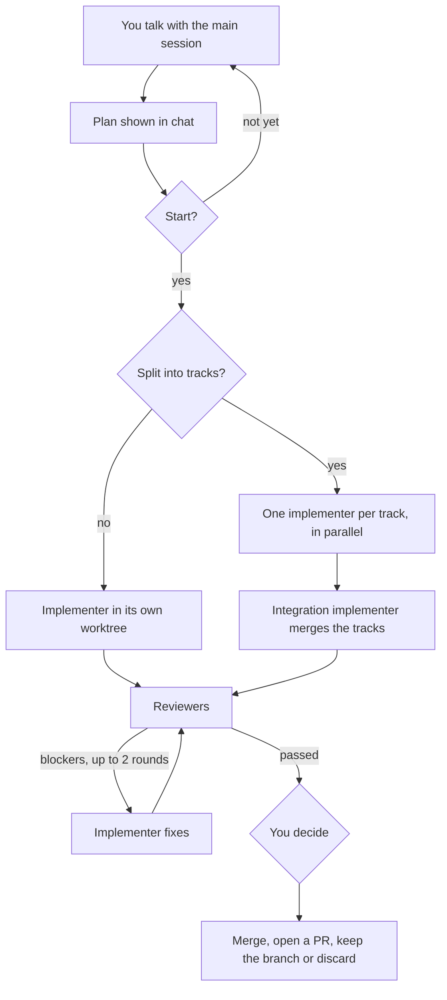

# Workflow

You don't run commands or remember steps. The main session follows the workflow by itself and asks you only when a decision is yours.

## The steps

1. **Talk.** You discuss the problem. The main session reads, searches and explains, but doesn't edit your files.
2. **Plan.** When the talk turns into a change, it restates the task, settles open questions and shows a plan in plain English.
3. **Start.** Nothing is built until you choose to start. You can save the plan to memory first, or open it in the hub.
4. **Implement.** An implementer agent builds the change on its own branch in its own git worktree, test first, and runs the plan's checks.
5. **Review.** Reviewer agents check the result. Blockers go back to the implementer for up to two fix rounds.
6. **You decide.** Merge locally, open a PR, keep the branch or discard it. You can look at the diff in the hub first.

## Talk-only main agent

The main session reads, searches, explains and discusses, but doesn't edit project files unless you ask for a direct edit. This rule is advisory; see [Limitations](limitations.md).

## Start gate and saved briefs

Nothing is built until you choose to start. Saving the plan to `<memory>/briefs/` first is recommended for medium and high complexity and skipped for small fixes. A saved plan can be opened in the [hub](hub.md) with **Open the plan** at the start gate.

## Implementer

An Opus agent builds the change in its own git worktree. It writes a failing test before a behaviour change, finds the root cause before a fix, commits in small steps and never pushes.

## Parallel tracks

When a plan splits into independent parts, an optional contract step fixes shared types or file layout first. Then one implementer builds each track at the same time, and an integration implementer merges them and runs the full checks. Reviews run once, on the combined result.

## Branch names

Each branch is named from the plan, such as `tf/hub-launcher-fix`. In a parallel run, tracks get `tf/<slug>-<track>` and the integration gets `tf/<slug>`.

## Reviewers

- Brief conformance, security and lint reviews always run.
- Architecture review runs for medium and high complexity.
- Test review runs when core business logic changes.

## Fix rounds

Blockers go back to the same implementer, and only the reviewers that failed run again. After two rounds with blockers still open, it stops and asks you.

## Merge options

You choose how to finish:

- merge locally
- open a PR (offered when the repo has a remote and `gh` is signed in)
- keep the branch
- fix the remaining should-fix items first
- discard, with an option to retry
- look at the diff in the hub first (**Look first**)

The buttons adapt to how the project ships, which is kept in a `shipping-preference` memory note. Options without a button can be typed as a reply. It pushes only when you open a PR.

## Agent models

The implementer and the security reviewer use Opus; the conformance, architecture and test reviewers use Sonnet; the lint reviewer uses Haiku. Edit the `model:` line in `agents/*.md` to change them.
